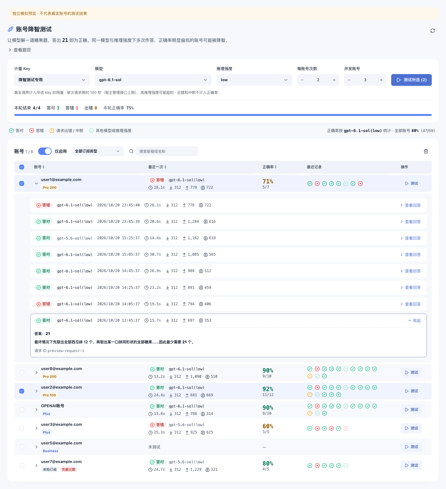

# 账号降智测试 · Codex Proxy 插件

为 [Codex Proxy RS](https://github.com/zyycn/codex-proxy-rs) 提供独立的账号降智测试页面：用一道**糖果题**（正确答案 21）批量测试已有 OpenAI 账号，按「模型 + 推理强度」统计每个账号的正确率，正确率明显偏低的账号可能被降智。请求经主服务原有的代理和凭据发出，不需要再填写 API 地址或密钥，也不修改主项目。

[下载 v0.4.0](https://github.com/sunjinqu/codex-model-health-plugin/releases/tag/v0.4.0) · [反馈问题](https://github.com/sunjinqu/codex-model-health-plugin/issues) · [插件使用规范](https://github.com/zyycn/codex-proxy-rs/blob/main/docs/plugins.md)

> 本仓库基于 [R-lmmortal/codex-model-health-plugin](https://github.com/R-lmmortal/codex-model-health-plugin)，增加了 Linux ARM64（aarch64）构建。从 v0.4.0 起移除 Meow / ModelTrace 行为指纹检测，改为糖果题降智测试，页面参照 [cpa-plugin-codex-candy-eval](https://github.com/haowang02/cpa-plugin-codex-candy-eval) 的糖果题页面重做。



## 来源与致谢

| 项目 | 使用内容 | 许可证 |
| --- | --- | --- |
| [codex-candy-eval](https://github.com/haowang02/codex-candy-eval) / [cpa-plugin-codex-candy-eval](https://github.com/haowang02/cpa-plugin-codex-candy-eval) — haowang02 | 糖果题题目、「独立出现的 21 即答对」判分规则、订阅类型名称，页面布局参考 | MIT |

宿主集成使用 [Codex Proxy 公开 SDK](https://github.com/zyycn/codex-proxy-rs/tree/af35cde3744b7afc81c4ad6e1e9c9c76bbbd68b8/backend/crates/gateway-plugin/sdk) 与 [@codex-proxy/ui](https://github.com/zyycn/codex-proxy-ui) v0.3.2。插件自身代码按 [PolyForm Noncommercial 1.0.0](LICENSE) 分发，第三方组件保留各自的许可证，详见 [NOTICE](NOTICE)，安装包中也附带这两个文件。

## 安装与兼容性

| 项目 | 当前支持 |
| --- | --- |
| 插件 ID / 版本 | `local.model-health` / `0.4.0` |
| 宿主清单范围 | `>=3.29.0, <4.0.0`（插件协议 4） |
| Release 平台 | Linux ARM64（aarch64），glibc 2.36+（如 Debian 12、Ubuntu 24.04）；x86_64 可按下文自行构建；不适用于 Alpine/musl 或 Windows |
| 运行方式 | `trustedProcess`，插件以宿主系统身份运行，安装代表完整信任；不是操作系统沙箱 |
| 扩展能力 | 独立管理页面；不注册请求中间件、调度器、观察器或自动维护任务 |

在 **插件管理 → 安装插件 → GitHub** 中填写：

```text
仓库：sunjinqu/codex-model-health-plugin
版本标签：v0.4.0（或留空查询最新稳定版）
```

选择 `local.model-health-0.4.0-aarch64-unknown-linux-gnu.tar.gz`，核对平台与摘要后安装并启用。服务器架构可用 `uname -m` 确认（`aarch64` 即 ARM64），glibc 版本可用 `ldd --version` 确认。也可从 [Releases](https://github.com/sunjinqu/codex-model-health-plugin/releases) 下载该文件，通过「上传包」安装。不要上传 GitHub 自动生成的 **Source code (zip/tar.gz)**，那是源码，不是插件制品。

Release 同时提供同名 `.tar.gz.sha256`，下载两个附件后可以校验：

```sh
sha256sum -c local.model-health-0.4.0-aarch64-unknown-linux-gnu.tar.gz.sha256
# macOS：shasum -a 256 -c local.model-health-0.4.0-aarch64-unknown-linux-gnu.tar.gz.sha256
```

### 从 0.3.x 升级

插件 ID 不变，在插件管理中直接更新同一插件即可。0.3.x 的 Meow / ModelTrace 检测历史仍保存在宿主的 `runs` 状态中，但新页面不再显示。清单继续声明这个命名空间，因为宿主不允许删除仍有记录的命名空间，否则会拒绝升级。需要保留旧报告的话，请在升级前截图或保留旧安装包，以便回退查看。

## 使用

1. 打开「账号降智测试」。页面列出主服务里全部 OpenAI 账号，账号优先显示去掉首尾空白后的邮箱，没有邮箱时显示账号名称。可以按「仅启用」、订阅类型和关键词筛选。
2. 在顶部选择**计量 Key**（用量记在这个 Key 上，分组和模型权限仍由主服务校验）、**模型**（该 Key 可见的模型）、**推理强度**，再设置**每账号次数**（1–10）和**并发账号**（1–8）。推理强度选 `默认` 时不发送 reasoning 参数，由主服务和上游决定。
3. 点击账号行的「测试」只测这一个账号；勾选若干账号后点「测试所选」；不勾选时点「测试全部」，会测试当前筛选结果中所有已启用的账号。每个账号内部串行作答，最多同时测试「并发账号」个账号，其余显示「排队中」。
4. 测试进行中可以点「停止」：正在进行的请求会完成并记录，之后不再发出新请求。离开插件页面同样会停止发出新请求。
5. 「正确率」只统计当前选中的模型与推理强度下判过分的回答。「最近记录」中，其他模型或推理强度的结果显示为浅色。点击记录图标或展开账号，可以查看每次的耗时、Token 用量和完整回答（Markdown 渲染）。
6. 列表右上角的垃圾桶清空所选账号（未勾选时为全部账号）的测试记录，正在测试的账号会被跳过。

## 判分与记录规则

- 回答中出现前后都不紧邻数字的 `21` 即判为**答对**，否则为**答错**。判分使用完整回答，保存的回答最多 3000 字节。
- 请求失败、超时、上游报错、模型拒答、回答被截断或没有文本时记为**出错**，不计入正确率，也不会自动重试，避免重复计费。
- 发送前先写入一条「测试中」记录。如果插件进程或页面在请求期间中断，这条记录会按「中断、结果未知」计为出错，不会被当成免费重试。
- 每个账号保留最近 20 次记录，保存在插件私有的 `candy` 状态命名空间（每个账号一条，CAS 更新），刷新页面或重启后仍在。
- 宿主单次管理请求的上限是 120 秒，所以**单次作答限时 100 秒**，超时记为出错。`high` / `xhigh` 等高推理强度更容易超时。
- 账号很多时，为了不超过管理接口 1 MiB 的响应上限，列表会自动减少每个账号显示的记录条数（页面会提示），实际保存的记录不受影响。

糖果题只能反映这一道题上的推理表现，不是模型身份认证。比较不同账号时，应使用相同的模型、推理强度和足够的次数。主服务的模型映射、提示词或中间件也可能影响实际响应，结果反映的是当前配置下这条链路的表现。

## 数据与执行

- 使用 `host.auth.list/get_runtime` 的非秘密账号资料、`host.keys.list` 和 `host.models.list`。页面只提交账号 ID 与 Key ID，不读取原始凭据。
- 每次作答前重新确认账号仍启用且属于 OpenAI 平台。每个 `host.model.execute_stream` 都显式指定 `account_id`、`client_key_id`、`provider=openai` 和 `protocol=openai`。主服务负责代理、鉴权、配额与最终计量，插件不另建 HTTP 出口。
- 请求体是一条 Responses 用户消息（题目原文），带 `stream: true`、`store: false`，并按所选推理强度附带 `reasoning.effort`，不带工具。
- 同一账号同一时间只允许一个作答请求，插件全局最多 8 个并发请求。网络等待期间不持有状态锁。
- 不改主服务数据库结构，不安装观察器、中间件或维护钩子，不自动定时测试。真实计费的测试只由使用者在页面上主动触发。

## 构建与验证

构建工具：Docker、Node 24+、pnpm 10.10、Python 3.9+（安装包冒烟测试）、Rust 1.99.1（构建打包 CLI）。SDK 与 CLI 固定在同一个宿主提交 `af35cde3744b7afc81c4ad6e1e9c9c76bbbd68b8`，前端依赖锁定在 `frontend/pnpm-lock.yaml`，不要换成浮动的 `main`。在仓库根目录执行：

```sh
cargo install --git https://github.com/zyycn/codex-proxy-rs.git \
  --rev af35cde3744b7afc81c4ad6e1e9c9c76bbbd68b8 \
  --locked --root .tools/cpr-cli codex-proxy-plugin-cli
CPR_PLUGIN_BIN="$PWD/.tools/cpr-cli/bin/cpr-plugin" ./scripts/build-linux.sh          # amd64 + arm64
CPR_PLUGIN_BIN="$PWD/.tools/cpr-cli/bin/cpr-plugin" ./scripts/build-linux.sh arm64    # 只构建 ARM64
```

`build-linux.sh` 依次执行：前端单测与构建，在 `rust:1.99.1-slim-bookworm` 容器中运行 Rust 测试并编译 Linux 二进制，用官方 CLI 生成 `dist/*.tar.gz` 和校验文件，最后用 `scripts/package-smoke.py` 做安装包冒烟验收。冒烟验收会核对 `bin/plugin` 的 ELF 架构与包目标一致，然后在非 root、空环境、只读根目录、`/tmp:noexec`、无网络的容器中，对离线 SDK 宿主夹具跑一遍答对、答错、详情、清空流程，不调用真实模型。与本机 CPU 不同的架构会通过 QEMU / Rosetta 模拟构建，速度较慢。

单独验证：

```sh
cargo test --manifest-path backend/Cargo.toml          # 单测 + 离线协议测试（模拟宿主回调）
pnpm --dir frontend install --frozen-lockfile
pnpm --dir frontend test && pnpm --dir frontend typecheck && pnpm --dir frontend build
pnpm --dir frontend dev                                # 打开 http://127.0.0.1:5173/?preview=1（模拟宿主）
node scripts/browser-qa.mjs                            # 需要 PLAYWRIGHT_PATH / CHROME_BINARY / PREVIEW_URL
```

预览参数：`theme=dark`，`scenario=empty|loading|error|many|slow`。浏览器预览会显式标注「模拟」，生产构建会剔除模拟宿主与模拟数据。

### GitHub Actions 自动构建

不想占用本地空间时，用 [.github/workflows/build.yml](.github/workflows/build.yml) 在 GitHub 的 ARM64 原生 runner 上执行同一个 `build-linux.sh arm64`，本地不需要 Docker、Rust 或前端依赖：

- 先把 `plugin.json` 等文件的版本号改好并推送，再推送同版本标签（如 `git tag v0.4.0 && git push origin v0.4.0`）。工作流会自动构建、测试、冒烟验收，并发布到同名 Release；Release 已存在时覆盖其中的安装包。标签与 `plugin.json` 版本不一致时直接失败。
- 在仓库 Actions 页面手动运行「Build ARM64 package」只做构建验收，安装包作为 artifact 下载，不改动 Release。

## 回退

安装新版时在插件管理中更新同一插件。升级前保留旧安装包并备份宿主数据；需要回退时使用插件详情中的「回退版本」或「切换版本」，选择已安装、已接受且兼容的旧制品。

回退到 0.3.x 前，**先在本页面清空全部账号的测试记录**。0.3.x 的清单没有 `candy` 命名空间，宿主发现这个命名空间里还有记录时会拒绝切换，以免丢数据。如果某个已从主服务删除的账号还留有记录，页面列不出它，也就清不掉，此时只能保持 0.4.x。回退成功后，旧的 Meow / ModelTrace 历史仍可查看。

配置回退不等于恢复私有数据，不能用卸载重装代替历史备份。停用本插件只会停止插件功能，不修改主项目代码或其他插件。

## 后续开发提示词

```text
继续开发 codex-model-health-plugin。先读 README.md、CLAUDE.md、plugin.json、backend/src 和 backend/tests/protocol.rs。
沿用 @codex-proxy/ui 与当前管理桥；保持账号/Key 显式绑定、发送前写 pending、中断计为出错、出错不计入正确率、单次作答不超过宿主 120 秒管理调用上限。
只改所请求的功能；补充离线协议测试和真实浏览器交互检查；不要自动部署或执行付费测试。
```
